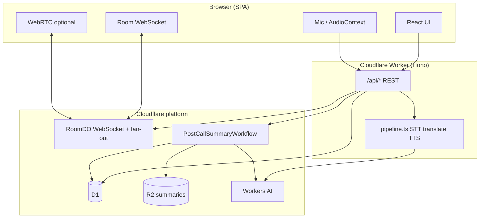
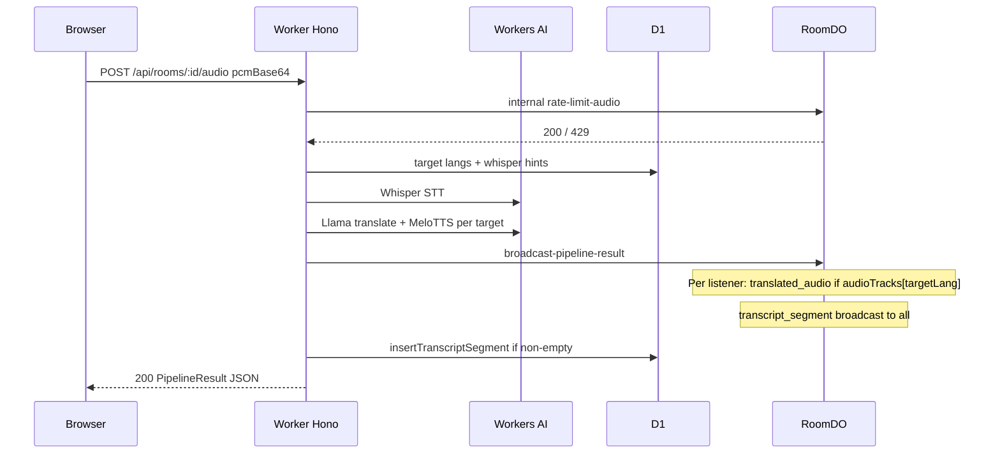

# Babel Room

Real-time **multilingual voice** on Cloudflare: capture speech in the browser, run **STT → translation → TTS** on the Worker with **Workers AI**, fan out **captions and translated audio** over **WebSockets** (Durable Object), persist metadata and transcripts in **D1**, optional **WebRTC** for natural peer audio when two or more people are in a room, and generate **post-call summaries** (Workflow + **R2**). The UI is **React + Vite + Tailwind**, shipped as static assets on the same Worker as `/api/*`.

---

## For newcomers: what runs where

| Layer | Role |
|-------|------|
| **Browser** | Mic capture (PCM), sequential TTS playback, transcript UI, optional WebRTC peer audio. Calls REST for room lifecycle and audio chunks; opens one WebSocket per room. |
| **Worker (Hono)** | HTTP API, CORS, orchestrates **Workers AI** pipeline, writes **D1**, triggers **RoomDO** internal fetches, starts **PostCallSummaryWorkflow**. |
| **RoomDO** (Durable Object) | One instance per `roomId` (name-based id). WebSocket hub: presence, signaling, broadcast transcripts, **targeted** translated MP3 to each listener’s `targetLang`. DO **SQLite** stores participants and audio rate-limit events across hibernation. |
| **D1** | Long-lived `rooms`, `participants`, `transcript_segments`; host id for permissions. |
| **R2** | `rooms/<roomId>/summary.json` written by the post-call workflow. |
| **Workers AI** | Whisper (STT), Llama (translate), MeloTTS (MP3 base64 per language). |

---

## Architecture



Static routing (production): `[assets]` in `apps/worker/wrangler.toml` points at `../web/dist` with `run_worker_first = ["/api/*"]` so only API and WebSocket upgrade paths execute the script; everything else is the SPA shell.

---

## Data flows

### 1. Create room → join → WebSocket

1. **POST `/api/rooms`** — Worker generates an 8-character `roomId`, inserts a `rooms` row in **D1**.
2. **POST `/api/rooms/:roomId/join`** — Body: `displayName`, `sourceLang` (speak), `targetLang` (hear). Worker inserts **D1** `participants`, assigns **host** if the room had none (`host_participant_id`), returns `participantId` and **`wsUrl`** (same host, `wss` in prod).
3. **GET `/api/rooms/:roomId/ws?...`** — Worker proxies to **RoomDO** (`idFromName(roomId)`). DO accepts the WebSocket, persists the participant in DO SQLite, sends `room_state`, broadcasts `participant_joined`.

### 2. Voice chunk: HTTP pipeline → DO fan-out



- **Rate limit**: DO tracks recent audio posts per participant; **429** if over limit.
- **Pipeline** (`apps/worker/src/pipeline.ts`): PCM → WAV for Whisper → optional silence gate → translate + TTS for each distinct **`targetLang`** in the room (from D1). Sanitized transcript text is stored and sent on the wire.
- **Fan-out** (`RoomDO.handlePipelineResult`): **Speaker does not** receive their own TTS. Each **other** participant gets `translated_audio` with MP3 base64 for **their** `targetLang`. **Everyone** gets `transcript_segment` (source + per-language strings for captions).
- **Web transcript UI** (`TranscriptPanel`): **Caption stream** — all buffered lines render in one scrollable column (lyrics / live-chat style). The client **coalesces** rapid segments from the same speaker (`useTranscript`) so long speech becomes fewer, longer cues. The list **auto-scrolls to the latest** line while you stay near the bottom; scrolling up shows history, with **Jump to latest** when unpinned. Each cue can show **primary + secondary** text inline (e.g. your language + original, or original + your language) without hiding everything behind a single “last line”. **Freshness** uses per-line `receivedAt`; **Copy transcript** exports the rolling buffer (line cap in `useTranscript`).

### 3. WebRTC (peer natural audio)

- With **two or more** participants, the UI can open a **mesh** WebRTC path: **`webrtc_signal`** messages (offer / answer / ICE) are relayed **only through RoomDO** to the named peer (`RoomClientMessage` in `@babel-room/shared`).
- **ICE servers**: **GET `/api/webrtc-ice`** returns STUN/TURN from env (see TURN section below).

### 4. End call → summary

1. **Host** calls **DELETE `/api/rooms/:roomId`** with `{ participantId }`. Worker sets `ended_at`, tells DO **`/internal/room-ended`** (broadcast `room_ended`, close sockets).
2. Worker enqueues **`PostCallSummaryWorkflow`** (`apps/worker/src/workflows.ts`): read **D1** transcript lines → **Llama** Markdown summary → **PUT** `rooms/<roomId>/summary.json` on **R2**.
3. Host polls **GET `/api/rooms/:roomId/summary?participantId=...`** until `status: "ready"` or still `pending`.

---

## HTTP API (surface)

| Method | Path | Purpose |
|--------|------|---------|
| POST | `/api/rooms` | Create room; returns `roomId`, `joinUrl`. |
| GET | `/api/rooms/:roomId` | Room metadata (exists, ended, participant count). |
| POST | `/api/rooms/:roomId/join` | Join; returns `participantId`, `wsUrl`, `isRoomHost`. |
| GET | `/api/rooms/:roomId/ws` | WebSocket upgrade (proxied to RoomDO). |
| POST | `/api/rooms/:roomId/audio` | Upload PCM chunk; runs AI pipeline; returns `PipelineResult`. |
| DELETE | `/api/rooms/:roomId` | End room (**host only**); triggers summary workflow. |
| GET | `/api/rooms/:roomId/summary` | Post-call notes from R2 (**host only**). |
| GET | `/api/webrtc-ice` | ICE server list for the browser. |

**Dev-only** (requires `BABEL_DEV_TOOLS=1` on the Worker): `GET .../dev/participants`, `POST .../dev/inject-transcript`, `POST .../dev/inject-translated-audio`.

Shared wire types and WebSocket payloads live in **`packages/shared`** (`Participant`, `WSMessageType`, `RoomClientMessage`, `PipelineResult`, etc.).

---

## Persistence model (D1)

- **`rooms`**: `id`, `created_at`, `ended_at`, `participant_count`, `host_participant_id` (first joiner).
- **`participants`**: `id`, `room_id`, display name, `source_language`, `target_language`, `joined_at`, `left_at`.
- **`transcript_segments`**: one row per non-empty STT segment (source text + language + timing); used by the summary workflow.

Migrations: `apps/worker/migrations/` — apply with `wrangler d1 migrations apply`.

**RoomDO SQLite** (separate from D1): in-memory + durable tables for `do_participants`, `room_meta`, `audio_rate_events` so presence and rate limits survive DO hibernation.

---

## Repository layout

| Path | Contents |
|------|----------|
| `apps/worker` | Hono app (`src/index.ts`), `RoomDO` (`room.ts`), `runAudioPipeline` (`pipeline.ts`), sanitize/schemas, D1 queries, migrations, Wrangler config. |
| `apps/web` | Vite SPA: `Room.tsx`, hooks (`useRoom`, `useWebRTC`, peer audio), `lib/api.ts`, transcript UI. |
| `packages/shared` | Shared TypeScript types for API and WebSocket. |
| `scripts/` | `ensure-web-dist.mjs`, `bootstrap-cloudflare.sh`. |

Root **`npm run dev`** runs local D1 migrations, Wrangler API on **8788**, and Vite on **5173** with `/api` proxied. See **Local development** below for other modes.

---

## Quick start (local)

From the **repository root** after `npm install`:

```bash
npm run dev
```

This applies **both** local D1 migrations, then starts **Wrangler** (API-only config on **8788**) and **Vite** (UI on **5173** with `/api` proxied to 8788). Open **`http://localhost:5173`**.

If you see **address already in use**, free the ports then retry:

```bash
npm run ports:free -w babel-room-worker
npm run dev
# or one shot:
npm run dev:free
```

Full Worker + static assets on a **single** port (no Vite): `cd apps/worker && npm run dev` → **`http://127.0.0.1:8787`**.

**Workers AI:** `wrangler dev --local` turns off [remote bindings](https://developers.cloudflare.com/workers/development-testing/#remote-bindings), which breaks the AI binding (`Binding AI needs to be run remotely`). Default `wrangler dev` (no `--local`) keeps D1/DO local while Workers AI calls the network.

### Invite links and testing languages

- **Copy invite link** in the room copies `/room/<code>`. Guests who open it get either your saved name/languages on this browser (`localStorage`) or a short **join** form (no more dead-end “start from home” when pasting a URL).
- Home URL with **`?join=xxxxxxxx`** pre-fills the 8-character join field (e.g. share `http://localhost:5173/?join=abcd1234`).
- **Real-time translation check:** use two profiles with **opposite** language pairs (e.g. Tab A: speak **English**, hear **Spanish**; Tab B or incognito: speak **Spanish**, hear **English**). Join the same room, allow the microphone on both, then speak from one side. With **two** participants in the room, the UI enables **WebRTC** so you hear each other’s natural voices; **translated TTS** (played sequentially so clips do not overlap) matches each listener’s “hear” language. The transcript can be shown in **your language** or **original** from toggles in the room. If someone’s “hear” language **matches** what you spoke, you still get **TTS playback** of that line so they are not silent.

### WebRTC and NAT (TURN)

Peer audio uses **WebRTC**. The SPA calls **`GET /api/webrtc-ice`** on your Worker for ICE servers: by default it returns two public **STUN** endpoints. For **production deployments**, set Worker var **`WEBRTC_ICE_SERVERS`** in `wrangler.toml` (or the dashboard) to a JSON array of [`RTCIceServer`](https://developer.mozilla.org/en-US/docs/Web/API/RTCIceServer) objects—usually including a **TURN** URL and credentials—then redeploy. Without TURN, many mobile or corporate networks will connect signaling but **fail to carry audio** (ICE may show “disconnected” or “failed” even when signaling works). If that happens, use **Reconnect peer** and **Play remote audio** in the room UI after clicking the page, then fix TURN. Optionally override at build time with **`VITE_WEBRTC_ICE_SERVERS`** for local or split-origin setups. **Headphones** are strongly recommended when both live and AI audio are on, to reduce echo.

### Room host (end call + notes)

The **first participant to join** a room becomes the **host** (`rooms.host_participant_id` in D1, migration `0003_room_host.sql`). Only the host may **end the call** (API requires their `participantId`) or **poll call notes** after the call. Share the invite link after you have joined if you need to be the host. Apply the migration locally and remotely after pulling this change.

---

## Production deploy

From the repo root (after `npx wrangler login` locally, or with `CLOUDFLARE_API_TOKEN` / `CLOUDFLARE_ACCOUNT_ID` in the environment):

```bash
npm run deploy
```

This builds `apps/web` into `apps/web/dist`, then deploys the Worker in `apps/worker` (API + static assets + DO / D1 / R2 / Workflows bindings per `wrangler.toml`).

**CORS:** `[vars] ALLOWED_ORIGINS` in `wrangler.toml` / `wrangler.test.toml` controls API access. Leave empty or set to `*` (via dashboard override) for permissive dev. In production, set a comma-separated allowlist, e.g. `https://babel-room-worker.your-account.workers.dev`.

**D1:** Migration `0002_drop_rooms_languages_used.sql` removes an unused column; apply remote/local migrations after upgrading the repo.

---

## CI/CD (GitHub Actions)

| Workflow | When it runs |
|----------|----------------|
| **CI** (`.github/workflows/ci.yml`) | Every **pull request**, and pushes to branches **other than** `main` — lint, test, production build. |
| **Deploy** (`.github/workflows/deploy.yml`) | Every **push to `main`** (and **Actions → Deploy → Run workflow** manually). Applies **D1 remote migrations**, then **`npm run deploy`**. |

### Required repository secrets

In GitHub: **Settings → Secrets and variables → Actions → New repository secret**

| Secret | Purpose |
|--------|---------|
| `CLOUDFLARE_API_TOKEN` | API token with permission to deploy this Worker, apply D1 migrations, and use bound resources (create under **My Profile → API Tokens**; template *Edit Cloudflare Workers* is a good start, then add D1/R2 if deploy fails). |
| `CLOUDFLARE_ACCOUNT_ID` | **Workers & Pages** overview → copy **Account ID** (32-char hex). |

Optional: add a [GitHub Environment](https://docs.github.com/en/actions/deployment/targeting-different-environments/using-environments-for-deployment) named `production` with required reviewers if you want a manual approval gate before deploy.

---

## Cloudflare resources (checklist)

| Resource | Wrangler / dashboard | Notes |
|----------|----------------------|--------|
| **D1** | `wrangler d1 create babel-room-db` | Put `database_id` in `apps/worker/wrangler.toml` (replace `REPLACE_WITH_REAL_ID`). |
| **D1 schema** | `wrangler d1 migrations apply babel-room-db --remote` | Same with `--local` for Miniflare / `wrangler dev --local`. |
| **R2** | `wrangler r2 bucket create babel-room-transcripts` | Name must match `bucket_name` in `wrangler.toml`. |
| **Workers AI** | Automatic with `[ai] binding = "AI"` | Uses account quota; models: whisper, Llama 3.1 8B, MeloTTS. |
| **Durable Objects** | `[[migrations]]` + `ROOM` binding | SQLite-backed `RoomDO` class. |
| **Workflows** | `[[workflows]]` block | `PostCallSummaryWorkflow` for post-call summaries to R2. |
| **Observability** | `[observability] enabled = true` | Logs/traces in the Workers dashboard. |

Quick helper (creates D1 + R2 if they do not exist; you still paste `database_id` and run migrations). **Run from the repository root** (the directory that contains `scripts/` and `apps/`). Run **`npm install`** there first so Wrangler is available from `node_modules` (the script does not rely on a global `wrangler`):

```bash
cd /path/to/babel-room   # your clone, e.g. ~/code/tools/babel-room
npm install
bash scripts/bootstrap-cloudflare.sh
```

### Optional: Cloudflare Realtime / RealtimeKit (SFU)

Not wired in this repo. When you add WebRTC SFU signaling, put token issuance in `apps/worker/src/realtime.ts` and add any **secrets** / **vars** in Wrangler; keep media on Workers + DO + AI as today until you integrate.

---

## Setup

1. **Login**

   ```bash
   npx wrangler login
   ```

2. **Install** (generates `apps/worker/worker-configuration.d.ts` via the worker `prepare` script — gitignored, recreated on `npm install`)

   ```bash
   npm install
   ```

3. **D1** — create DB, set `database_id` in `apps/worker/wrangler.toml`, apply migrations:

   ```bash
   cd apps/worker
   npx wrangler d1 create babel-room-db
   npx wrangler d1 migrations apply babel-room-db --remote
   # local persistence:
   npx wrangler d1 migrations apply babel-room-db --local
   ```

4. **R2** — create the bucket name from `wrangler.toml`.

5. **Deploy UI + Worker** (from repo root):

   ```bash
   npm run deploy
   ```

   Or manually: `npm run build -w babel-room-web` then `cd apps/worker && npm run deploy`.

After deploy, open the **Workers** route URL; `/` is the SPA and `/api/*` is the API (same origin, no `VITE_API_BASE_URL` needed).

---

## Local development

| What you run | Ports | Open |
|--------------|-------|------|
| **`npm run dev`** (repo root) | Worker **8788** + Vite **5173** | **`http://localhost:5173`** — same as Quick start. |
| **`cd apps/worker && npm run dev`** | **8787** only | **`http://127.0.0.1:8787`** — Wrangler + built static assets (no Vite hot reload). |
| **`cd apps/worker && npm run dev:api`** | Worker **8788** | Use with Vite separately, or use root **`npm run dev`**. |

Wrangler dev always passes **`--port 8787`** or **`--port 8788`** so the listen port does not fall back to a stale value. Use **`npx wrangler`** (or **`npm run`** in `apps/worker`) — a global **`wrangler`** binary is optional.

**`npm run db:setup:local -w babel-room-worker`** applies migrations for **both** local D1 bindings (main + test config). Root **`npm run dev`** runs that first.

---

## Tests

```bash
cd apps/worker
npm test
```

Vitest uses `wrangler.test.toml` (no static assets folder). `isolatedStorage: false` is required when Workflows are defined.

---

## Known limitations

- **TTS latency** is often on the order of **~300ms per language** on Workers AI.
- **MeloTTS** returns **MP3** (base64), not raw PCM; the web client uses `decodeAudioData`.
- **RoomDO** persists participants in DO SQLite so state survives hibernation.
